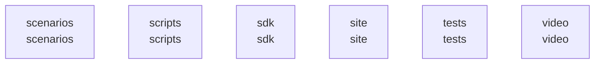

# overall-architecture/group-2

[解析トップへ戻る](../../README.md)

このグループは表示用の区切りです。独立した実行モジュールではありません。

## 要素の説明

### n-scenarios-c254d1

確認したパス: `scenarios`。配下の登録ファイルは10件。

- `scenarios/adversarial/false-completion-trap.yaml`（一覧のみ）
- `scenarios/casual/friend-chat.yaml`（一覧のみ）
- `scenarios/casual/friend-profile-intake.yaml`（一覧のみ）
- `scenarios/friend/friend-hype.yaml`（一覧のみ）
- `scenarios/hotel/impossible-hotel.yaml`（一覧のみ）
- `scenarios/restaurant/restaurant-reservation-en.yaml`（一覧のみ）
- `scenarios/restaurant/restaurant-reservation-intake.yaml`（一覧のみ）
- `scenarios/restaurant/restaurant-reservation.yaml`（一覧のみ）
- `scenarios/serial/serial-number.yaml`（一覧のみ）
- `scenarios/shop/bulk-buy.yaml`（一覧のみ）

[詳細な図と説明を見る](n-scenarios-c254d1/README.md)

### n-scripts-16728d

確認したパス: `scripts`。配下の登録ファイルは44件。

- `scripts/add-bgm.sh`（一覧のみ）
- `scripts/battle-to-calls.mjs`（一覧のみ）
- `scripts/build-site.mjs`（一覧のみ）
- `scripts/bundle-cli.mjs`（一覧のみ）
- `scripts/capture-demo.mjs`（一覧のみ）
- `scripts/check-deps.mjs`（一覧のみ）
- `scripts/export-recorded-check.mjs`（一覧のみ）
- `scripts/growth-snapshot.mjs`（一覧のみ）
- `scripts/make-sfx.sh`（一覧のみ）
- `scripts/pkgjson.mjs`（一覧のみ）
- `scripts/publish-x-intake.mjs`（一覧のみ）
- `scripts/reception-sim.mjs`（一覧のみ）
- `scripts/record-evidence-demo.mjs`（一覧のみ）
- `scripts/render-battle2.mjs`（一覧のみ）
- `scripts/render-scene.mjs`（一覧のみ）
- `scripts/render-video.mjs`（一覧のみ）
- `scripts/ui-quality.mjs`（一覧のみ）
- `scripts/ui-stop-gate.mjs`（一覧のみ）
- `scripts/ui/.tmp-proto.mjs`（一覧のみ）
- `scripts/ui/cdp.mjs`（一覧のみ）
- `scripts/ui/chat-news.mjs`（一覧のみ）
- `scripts/ui/dead-links.mjs`（一覧のみ）
- `scripts/ui/email-login.mjs`（一覧のみ）
- `scripts/ui/gateway-app.mjs`（一覧のみ）
- `scripts/ui/gateway-chat.mjs`（一覧のみ）
- `scripts/ui/gateway-flow.mjs`（一覧のみ）
- `scripts/ui/gateway-local.mjs`（一覧のみ）
- `scripts/ui/layout-faults.mjs`（一覧のみ）
- `scripts/ui/live-serves.mjs`（一覧のみ）
- `scripts/ui/managed-bookings.mjs`（一覧のみ）
- `scripts/ui/managed-credits.mjs`（一覧のみ）
- `scripts/ui/managed-phone.mjs`（一覧のみ）
- `scripts/ui/managed-recovery.mjs`（一覧のみ）
- `scripts/ui/managed-states.mjs`（一覧のみ）
- `scripts/ui/metered-credits.mjs`（一覧のみ）

[詳細な図と説明を見る](n-scripts-16728d/README.md)

### n-sdk-5a374d

確認したパス: `sdk`。配下の登録ファイルは11件。

- `sdk/capability-sdk/README.md`（一覧のみ）
- `sdk/capability-sdk/index.d.mts`（一覧のみ）
- `sdk/capability-sdk/index.mjs`（一覧のみ）
- `sdk/capability-sdk/package.json`（一覧のみ）
- `sdk/channel-sdk/README.md`（一覧のみ）
- `sdk/channel-sdk/index.d.mts`（一覧のみ）
- `sdk/channel-sdk/index.mjs`（一覧のみ）
- `sdk/channel-sdk/package.json`（一覧のみ）
- `sdk/gateway-client/connection-file.mjs`（内容確認済み）
- `sdk/gateway-client/index.mjs`（一覧のみ）
- `sdk/plugin-kit/index.mjs`（一覧のみ）

[詳細な図と説明を見る](n-sdk-5a374d/README.md)

### n-site-c099a4

確認したパス: `site`。配下の登録ファイルは27件。

- `site/check.css`（一覧のみ）
- `site/check.html`（一覧のみ）
- `site/check.js`（一覧のみ）
- `site/craft.css`（一覧のみ）
- `site/data/call-gpt4o-mini.json`（一覧のみ）
- `site/data/recorded-check.json`（一覧のみ）
- `site/data/wave.svg.html`（一覧のみ）
- `site/en/check.html`（一覧のみ）
- `site/en/index.html`（一覧のみ）
- `site/en/lab.html`（一覧のみ）
- `site/evidence-clarity.css`（一覧のみ）
- `site/evidence.css`（一覧のみ）
- `site/index.html`（一覧のみ）
- `site/lab.css`（一覧のみ）
- `site/lab.html`（一覧のみ）
- `site/legacy.js`（一覧のみ）
- `site/mark.png`（一覧のみ）
- `site/onboarding.css`（一覧のみ）
- `site/playground.css`（一覧のみ）
- `site/portfolio.css`（一覧のみ）
- `site/portfolio.js`（一覧のみ）
- `site/robots.txt`（一覧のみ）
- `site/sitemap.xml`（一覧のみ）
- `site/src/check.ts`（一覧のみ）
- `site/src/playground.ts`（一覧のみ）
- `site/src/story.ts`（一覧のみ）
- `site/story.js`（一覧のみ）

[詳細な図と説明を見る](n-site-c099a4/README.md)

### n-tests-04d13f

確認したパス: `tests`。配下の登録ファイルは3件。

- `tests/speaker-lines.regression.test.mjs`（一覧のみ）
- `tests/transcript-delivery.integration.test.mjs`（一覧のみ）
- `tests/ui-gate.test.mjs`（一覧のみ）

[詳細な図と説明を見る](n-tests-04d13f/README.md)

### n-video-ffbaf5

確認したパス: `video`。配下の登録ファイルは19件。

- `video/.work/battle.json`（一覧のみ）
- `video/.work/tts/g1-ft.wav`（一覧のみ）
- `video/.work/tts/g2-ft.wav`（一覧のみ）
- `video/.work/tts/g3-ft.wav`（一覧のみ）
- `video/.work/tts/g4-ft.wav`（一覧のみ）
- `video/.work/tts/gl-ft.wav`（一覧のみ）
- `video/.work/tts/h0-ft.wav`（一覧のみ）
- `video/.work/tts/h1-ft.wav`（一覧のみ）
- `video/.work/tts/h2-ft.wav`（一覧のみ）
- `video/.work/tts/h3-ft.wav`（一覧のみ）
- `video/.work/tts/hf-ft.wav`（一覧のみ）
- `video/.work/tts/hm-ft.wav`（一覧のみ）
- `video/.work/tts/lines.json`（一覧のみ）
- `video/.work/tts/m1-ft.wav`（一覧のみ）
- `video/2026-09-22/storyboard.md`（一覧のみ）
- `video/battle.html`（一覧のみ）
- `video/battle2.html`（一覧のみ）
- `video/bgm/soft-circuit.m4a`（一覧のみ）
- `video/template.html`（一覧のみ）

[詳細な図と説明を見る](n-video-ffbaf5/README.md)

