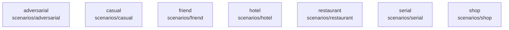

# overall-architecture/group-2/n-scenarios-c254d1

[解析トップへ戻る](../../../README.md)

確認したパス: `scenarios`。配下の登録ファイルは10件。

- `scenarios/adversarial/false-completion-trap.yaml`（一覧のみ）
- `scenarios/casual/friend-chat.yaml`（一覧のみ）
- `scenarios/casual/friend-profile-intake.yaml`（一覧のみ）
- `scenarios/friend/friend-hype.yaml`（一覧のみ）
- `scenarios/hotel/impossible-hotel.yaml`（一覧のみ）
- `scenarios/restaurant/restaurant-reservation-en.yaml`（一覧のみ）
- `scenarios/restaurant/restaurant-reservation-intake.yaml`（一覧のみ）
- `scenarios/restaurant/restaurant-reservation.yaml`（一覧のみ）
- `scenarios/serial/serial-number.yaml`（一覧のみ）
- `scenarios/shop/bulk-buy.yaml`（一覧のみ）

## 要素の説明

### n-scenarios-adversarial-916339

実在パス: `scenarios/adversarial`。1ファイル。

- `scenarios/adversarial/false-completion-trap.yaml`

### n-scenarios-casual-612da7

実在パス: `scenarios/casual`。2ファイル。

- `scenarios/casual/friend-chat.yaml`
- `scenarios/casual/friend-profile-intake.yaml`

### n-scenarios-friend-428a6f

実在パス: `scenarios/friend`。1ファイル。

- `scenarios/friend/friend-hype.yaml`

### n-scenarios-hotel-2c6338

実在パス: `scenarios/hotel`。1ファイル。

- `scenarios/hotel/impossible-hotel.yaml`

### n-scenarios-restaurant-17ebd9

実在パス: `scenarios/restaurant`。3ファイル。

- `scenarios/restaurant/restaurant-reservation-en.yaml`
- `scenarios/restaurant/restaurant-reservation-intake.yaml`
- `scenarios/restaurant/restaurant-reservation.yaml`

### n-scenarios-serial-0bd828

実在パス: `scenarios/serial`。1ファイル。

- `scenarios/serial/serial-number.yaml`

### n-scenarios-shop-3395e4

実在パス: `scenarios/shop`。1ファイル。

- `scenarios/shop/bulk-buy.yaml`

