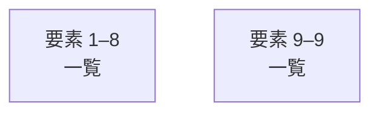

# overall-architecture/group-2/n-scripts-16728d

[解析トップへ戻る](../../../README.md)

確認したパス: `scripts`。配下の登録ファイルは44件。

- `scripts/add-bgm.sh`（一覧のみ）
- `scripts/battle-to-calls.mjs`（一覧のみ）
- `scripts/build-site.mjs`（一覧のみ）
- `scripts/bundle-cli.mjs`（一覧のみ）
- `scripts/capture-demo.mjs`（一覧のみ）
- `scripts/check-deps.mjs`（一覧のみ）
- `scripts/export-recorded-check.mjs`（一覧のみ）
- `scripts/growth-snapshot.mjs`（一覧のみ）
- `scripts/make-sfx.sh`（一覧のみ）
- `scripts/pkgjson.mjs`（一覧のみ）
- `scripts/publish-x-intake.mjs`（一覧のみ）
- `scripts/reception-sim.mjs`（一覧のみ）
- `scripts/record-evidence-demo.mjs`（一覧のみ）
- `scripts/render-battle2.mjs`（一覧のみ）
- `scripts/render-scene.mjs`（一覧のみ）
- `scripts/render-video.mjs`（一覧のみ）
- `scripts/ui-quality.mjs`（一覧のみ）
- `scripts/ui-stop-gate.mjs`（一覧のみ）
- `scripts/ui/.tmp-proto.mjs`（一覧のみ）
- `scripts/ui/cdp.mjs`（一覧のみ）
- `scripts/ui/chat-news.mjs`（一覧のみ）
- `scripts/ui/dead-links.mjs`（一覧のみ）
- `scripts/ui/email-login.mjs`（一覧のみ）
- `scripts/ui/gateway-app.mjs`（一覧のみ）
- `scripts/ui/gateway-chat.mjs`（一覧のみ）
- `scripts/ui/gateway-flow.mjs`（一覧のみ）
- `scripts/ui/gateway-local.mjs`（一覧のみ）
- `scripts/ui/layout-faults.mjs`（一覧のみ）
- `scripts/ui/live-serves.mjs`（一覧のみ）
- `scripts/ui/managed-bookings.mjs`（一覧のみ）
- `scripts/ui/managed-credits.mjs`（一覧のみ）
- `scripts/ui/managed-phone.mjs`（一覧のみ）
- `scripts/ui/managed-recovery.mjs`（一覧のみ）
- `scripts/ui/managed-states.mjs`（一覧のみ）
- `scripts/ui/metered-credits.mjs`（一覧のみ）

## 要素の説明

### group-1

このグループは表示用の区切りです。独立した実行モジュールではありません。

[詳細な図と説明を見る](group-1/README.md)

### group-2

このグループは表示用の区切りです。独立した実行モジュールではありません。

[詳細な図と説明を見る](group-2/README.md)

