# overall-architecture/group-2/n-scripts-16728d/group-1

[解析トップへ戻る](../../../../README.md)

このグループは表示用の区切りです。独立した実行モジュールではありません。

```mermaid
graph TD
    n-scripts-ui-000ff0["ui\nscripts/ui"]
    n-scripts-battle-to-calls-mjs-b93f78["battle-to-calls.mjs\nscripts/battle-to-calls.mjs"]
    n-scripts-build-site-mjs-150df9["build-site.mjs\nscripts/build-site.mjs"]
    n-scripts-bundle-cli-mjs-6b3f19["bundle-cli.mjs\nscripts/bundle-cli.mjs"]
    n-scripts-capture-demo-mjs-cfe35c["capture-demo.mjs\nscripts/capture-demo.mjs"]
    n-scripts-check-deps-mjs-34d86e["check-deps.mjs\nscripts/check-deps.mjs"]
    n-scripts-export-recorded-check-mjs-cdeabe["export-recorded-check.mjs\nscripts/export-recorded-check.mjs"]
    n-scripts-growth-snapshot-mjs-09036a["growth-snapshot.mjs\nscripts/growth-snapshot.mjs"]
```

## 要素の説明

### n-scripts-battle-to-calls-mjs-b93f78

実在パス: `scripts/battle-to-calls.mjs`。1ファイル。

- `scripts/battle-to-calls.mjs`

### n-scripts-build-site-mjs-150df9

実在パス: `scripts/build-site.mjs`。1ファイル。

- `scripts/build-site.mjs`

### n-scripts-bundle-cli-mjs-6b3f19

実在パス: `scripts/bundle-cli.mjs`。1ファイル。

- `scripts/bundle-cli.mjs`

### n-scripts-capture-demo-mjs-cfe35c

実在パス: `scripts/capture-demo.mjs`。1ファイル。

- `scripts/capture-demo.mjs`

### n-scripts-check-deps-mjs-34d86e

実在パス: `scripts/check-deps.mjs`。1ファイル。

- `scripts/check-deps.mjs`

### n-scripts-export-recorded-check-mjs-cdeabe

実在パス: `scripts/export-recorded-check.mjs`。1ファイル。

- `scripts/export-recorded-check.mjs`

### n-scripts-growth-snapshot-mjs-09036a

実在パス: `scripts/growth-snapshot.mjs`。1ファイル。

- `scripts/growth-snapshot.mjs`

### n-scripts-ui-000ff0

実在パス: `scripts/ui`。23ファイル。

- `scripts/ui/.tmp-proto.mjs`
- `scripts/ui/cdp.mjs`
- `scripts/ui/chat-news.mjs`
- `scripts/ui/dead-links.mjs`
- `scripts/ui/email-login.mjs`
- `scripts/ui/gateway-app.mjs`
- `scripts/ui/gateway-chat.mjs`
- `scripts/ui/gateway-flow.mjs`
- `scripts/ui/gateway-local.mjs`
- `scripts/ui/layout-faults.mjs`
- `scripts/ui/live-serves.mjs`
- `scripts/ui/managed-bookings.mjs`
- `scripts/ui/managed-credits.mjs`
- `scripts/ui/managed-phone.mjs`
- `scripts/ui/managed-recovery.mjs`
- `scripts/ui/managed-states.mjs`
- `scripts/ui/metered-credits.mjs`
- `scripts/ui/quality-preview.mjs`
- `scripts/ui/site-craft.mjs`
- `scripts/ui/site-links.mjs`
- `scripts/ui/site-local-analytics.mjs`
- `scripts/ui/usage-cost.mjs`
- `scripts/ui/workspace-session.mjs`

