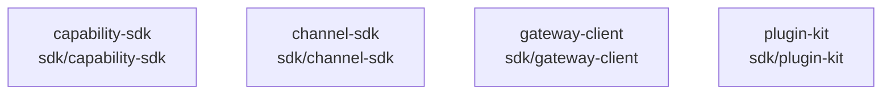

# overall-architecture/group-2/n-sdk-5a374d

[解析トップへ戻る](../../../README.md)

確認したパス: `sdk`。配下の登録ファイルは11件。

- `sdk/capability-sdk/README.md`（一覧のみ）
- `sdk/capability-sdk/index.d.mts`（一覧のみ）
- `sdk/capability-sdk/index.mjs`（一覧のみ）
- `sdk/capability-sdk/package.json`（一覧のみ）
- `sdk/channel-sdk/README.md`（一覧のみ）
- `sdk/channel-sdk/index.d.mts`（一覧のみ）
- `sdk/channel-sdk/index.mjs`（一覧のみ）
- `sdk/channel-sdk/package.json`（一覧のみ）
- `sdk/gateway-client/connection-file.mjs`（内容確認済み）
- `sdk/gateway-client/index.mjs`（一覧のみ）
- `sdk/plugin-kit/index.mjs`（一覧のみ）

## 要素の説明

### n-sdk-capability-sdk-33bb38

実在パス: `sdk/capability-sdk`。4ファイル。

- `sdk/capability-sdk/README.md`
- `sdk/capability-sdk/index.d.mts`
- `sdk/capability-sdk/index.mjs`
- `sdk/capability-sdk/package.json`

### n-sdk-channel-sdk-9eabb3

実在パス: `sdk/channel-sdk`。4ファイル。

- `sdk/channel-sdk/README.md`
- `sdk/channel-sdk/index.d.mts`
- `sdk/channel-sdk/index.mjs`
- `sdk/channel-sdk/package.json`

### n-sdk-gateway-client-2d47dc

実在パス: `sdk/gateway-client`。2ファイル。

- `sdk/gateway-client/connection-file.mjs`
- `sdk/gateway-client/index.mjs`

### n-sdk-plugin-kit-4df66c

実在パス: `sdk/plugin-kit`。1ファイル。

- `sdk/plugin-kit/index.mjs`

