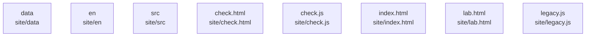

# overall-architecture/group-2/n-site-c099a4/group-1

[解析トップへ戻る](../../../../README.md)

このグループは表示用の区切りです。独立した実行モジュールではありません。

## 要素の説明

### n-site-check-html-956200

実在パス: `site/check.html`。1ファイル。

- `site/check.html`

### n-site-check-js-c7dd17

実在パス: `site/check.js`。1ファイル。

- `site/check.js`

### n-site-data-8cdbc3

実在パス: `site/data`。3ファイル。

- `site/data/call-gpt4o-mini.json`
- `site/data/recorded-check.json`
- `site/data/wave.svg.html`

### n-site-en-ea3025

実在パス: `site/en`。3ファイル。

- `site/en/check.html`
- `site/en/index.html`
- `site/en/lab.html`

### n-site-index-html-f8b5f3

実在パス: `site/index.html`。1ファイル。

- `site/index.html`

### n-site-lab-html-c2de30

実在パス: `site/lab.html`。1ファイル。

- `site/lab.html`

### n-site-legacy-js-53c5c4

実在パス: `site/legacy.js`。1ファイル。

- `site/legacy.js`

### n-site-src-175816

実在パス: `site/src`。3ファイル。

- `site/src/check.ts`
- `site/src/playground.ts`
- `site/src/story.ts`

