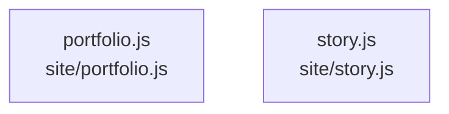

# overall-architecture/group-2/n-site-c099a4/group-2

[解析トップへ戻る](../../../../README.md)

このグループは表示用の区切りです。独立した実行モジュールではありません。

## 要素の説明

### n-site-portfolio-js-67edca

実在パス: `site/portfolio.js`。1ファイル。

- `site/portfolio.js`

### n-site-story-js-a61b00

実在パス: `site/story.js`。1ファイル。

- `site/story.js`

