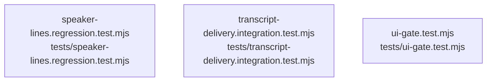

# overall-architecture/group-2/n-tests-04d13f

[解析トップへ戻る](../../../README.md)

確認したパス: `tests`。配下の登録ファイルは3件。

- `tests/speaker-lines.regression.test.mjs`（一覧のみ）
- `tests/transcript-delivery.integration.test.mjs`（一覧のみ）
- `tests/ui-gate.test.mjs`（一覧のみ）

## 要素の説明

### n-tests-speaker-lines-regression-test-mjs-1ab524

実在パス: `tests/speaker-lines.regression.test.mjs`。1ファイル。

- `tests/speaker-lines.regression.test.mjs`

### n-tests-transcript-delivery-integration-test-mjs-3352b9

実在パス: `tests/transcript-delivery.integration.test.mjs`。1ファイル。

- `tests/transcript-delivery.integration.test.mjs`

### n-tests-ui-gate-test-mjs-1dfa35

実在パス: `tests/ui-gate.test.mjs`。1ファイル。

- `tests/ui-gate.test.mjs`

