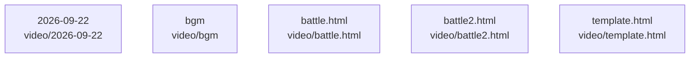

# overall-architecture/group-2/n-video-ffbaf5

[解析トップへ戻る](../../../README.md)

確認したパス: `video`。配下の登録ファイルは19件。

- `video/.work/battle.json`（一覧のみ）
- `video/.work/tts/g1-ft.wav`（一覧のみ）
- `video/.work/tts/g2-ft.wav`（一覧のみ）
- `video/.work/tts/g3-ft.wav`（一覧のみ）
- `video/.work/tts/g4-ft.wav`（一覧のみ）
- `video/.work/tts/gl-ft.wav`（一覧のみ）
- `video/.work/tts/h0-ft.wav`（一覧のみ）
- `video/.work/tts/h1-ft.wav`（一覧のみ）
- `video/.work/tts/h2-ft.wav`（一覧のみ）
- `video/.work/tts/h3-ft.wav`（一覧のみ）
- `video/.work/tts/hf-ft.wav`（一覧のみ）
- `video/.work/tts/hm-ft.wav`（一覧のみ）
- `video/.work/tts/lines.json`（一覧のみ）
- `video/.work/tts/m1-ft.wav`（一覧のみ）
- `video/2026-09-22/storyboard.md`（一覧のみ）
- `video/battle.html`（一覧のみ）
- `video/battle2.html`（一覧のみ）
- `video/bgm/soft-circuit.m4a`（一覧のみ）
- `video/template.html`（一覧のみ）

## 要素の説明

### n-video-2026-09-22-017eed

実在パス: `video/2026-09-22`。1ファイル。

- `video/2026-09-22/storyboard.md`

### n-video-battle-html-a99289

実在パス: `video/battle.html`。1ファイル。

- `video/battle.html`

### n-video-battle2-html-e53f7f

実在パス: `video/battle2.html`。1ファイル。

- `video/battle2.html`

### n-video-bgm-ba5481

実在パス: `video/bgm`。1ファイル。

- `video/bgm/soft-circuit.m4a`

### n-video-template-html-508864

実在パス: `video/template.html`。1ファイル。

- `video/template.html`

