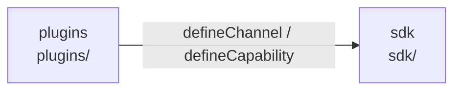

# overall-architecture/plugins-sdk

[解析トップへ戻る](../README.md) ・ [ひとつ上へ](../README.md)

Gateway の外にある素の ESM。sdk は何にも依存せず、plugins は sdk だけを import する。詳しくは extension-points を参照。

## 要素

### plugins

同梱9件（line、slack、twilio-messaging、call、email、calendar、sms、whatsapp、crm）と、外部プラグインの例 telegram。

[説明を見る](plugins/README.md)

### sdk

plugin-kit（manifest 検証と登録）、channel-sdk、capability-sdk、gateway-client（Gateway v1 のクライアント）。

[説明を見る](sdk/README.md)
