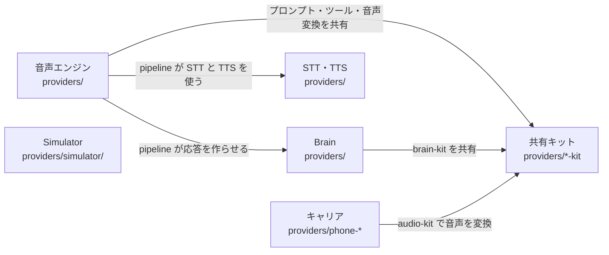

# overall-architecture/providers

[解析トップへ戻る](../README.md) ・ [ひとつ上へ](../README.md)

Phone Layer と Voice Layer の具体的な実装。キャリア（phone-*）と音声エンジン（openai-realtime、gemini-live、voice-pipeline）は互いに import しない。共有するものは voice-kit・audio-kit・brain-kit に置く。

## 要素

### brains

core の BrainProvider を実装する LLM。runtime と pipeline エンジンの応答を作る。

[詳細な図と説明を見る](brains/README.md)

### carriers

PhoneProvider を実装し、dial() で CarrierMediaSession を返す CarrierTransport を作る。Twilio は Media Streams の WebSocket で直接つなぎ、Plivo と汎用 SIP は SipGateway 経由でつなぐ。

[詳細な図と説明を見る](carriers/README.md)

### shared-kits

キャリアとエンジンが互いに依存しないための共通部品。

[詳細な図と説明を見る](shared-kits/README.md)

### simulator

API キーも電話番号も使わない疑似通話。core の TransportProvider を直接実装し、Phone/Voice Layer を通らない。台本キャラクター（characters/）は truth() を実装し、eval が偽の完了を検出できるようにする。

[説明を見る](simulator/README.md)

### speech-parts

pipeline エンジンが使う音声認識と音声合成。

[詳細な図と説明を見る](speech-parts/README.md)

### voice-engines

VoiceEngine を実装する。gpt-live と gemini-live は音声から音声を直接生成し、pipeline は STT → Brain → TTS を組み合わせる。

[詳細な図と説明を見る](voice-engines/README.md)
