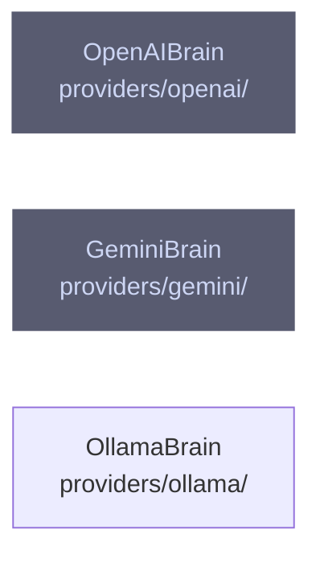

# overall-architecture/providers/brains

[解析トップへ戻る](../../README.md) ・ [ひとつ上へ](../README.md)

core の BrainProvider を実装する LLM。runtime と pipeline エンジンの応答を作る。

## 要素

### gemini-brain

Gemini の generateContent を使う Brain。

[説明を見る](gemini-brain/README.md)

### ollama

ローカルの Ollama を使う Brain。

[説明を見る](ollama/README.md)

### openai-brain

OpenAI の Chat API を使う Brain。

[説明を見る](openai-brain/README.md)
