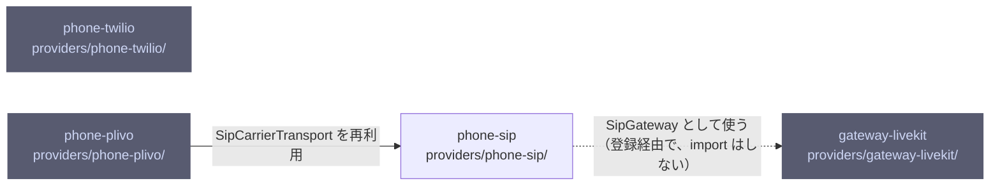

# overall-architecture/providers/carriers

[解析トップへ戻る](../../README.md) ・ [ひとつ上へ](../README.md)

PhoneProvider を実装し、dial() で CarrierMediaSession を返す CarrierTransport を作る。Twilio は Media Streams の WebSocket で直接つなぎ、Plivo と汎用 SIP は SipGateway 経由でつなぐ。

## 要素

### gateway-livekit

SipGateway の最初の実装（LiveKit）。トランクの用意、発信、ルームの音声の送受信。LiveKit は実装の一つで、仕様ではない。

[説明を見る](gateway-livekit/README.md)

### phone-plivo

Plivo Zentrunk の発信トランクの用意・診断・料金。通話は phone-sip の SipCarrierTransport に任せる。

[説明を見る](phone-plivo/README.md)

### phone-sip

任意の SIP トランクを、SipGateway 経由の CarrierTransport にする汎用実装。

[説明を見る](phone-sip/README.md)

### phone-twilio

Twilio の REST で発信し、Media Streams の WebSocket で μ-law 8k を直接やり取りする。録音する場合は録音告知を自分で流す。

[説明を見る](phone-twilio/README.md)
