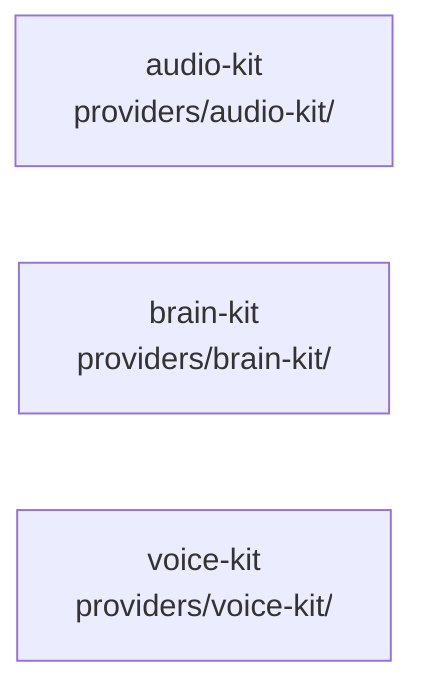

# overall-architecture/providers/shared-kits

[解析トップへ戻る](../../README.md) ・ [ひとつ上へ](../README.md)

キャリアとエンジンが互いに依存しないための共通部品。

## 要素

### audio-kit

G.711 μ-law、リサンプル、WAV、20ms のフレーム分割。

[説明を見る](audio-kit/README.md)

### brain-kit

LLM Brain に共通のプロンプト組み立て、JSON の解析、費用見積もり。

[説明を見る](brain-kit/README.md)

### voice-kit

音声エンジン共通のプロンプト、受付・予約のツール、別れ際の検出、S2SVoiceSession、声の設定。

[説明を見る](voice-kit/README.md)
