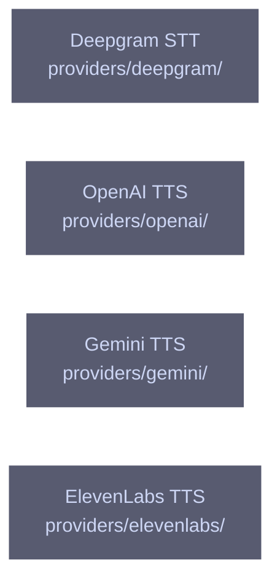

# overall-architecture/providers/speech-parts

[解析トップへ戻る](../../README.md) ・ [ひとつ上へ](../README.md)

pipeline エンジンが使う音声認識と音声合成。

## 要素

### deepgram

Deepgram のストリーミング認識（WebSocket）。

[説明を見る](deepgram/README.md)

### elevenlabs

ElevenLabs の REST で ulaw_8000 を直接合成する。--tts elevenlabs で pipeline に注入される。他の @oathra パッケージに依存しない。

[説明を見る](elevenlabs/README.md)

### gemini-tts

character-tts エンジンと --tts gemini-lite で使う。

[説明を見る](gemini-tts/README.md)

### openai-tts

pipeline の既定の TTS。告知音声の合成にも使う。

[説明を見る](openai-tts/README.md)
