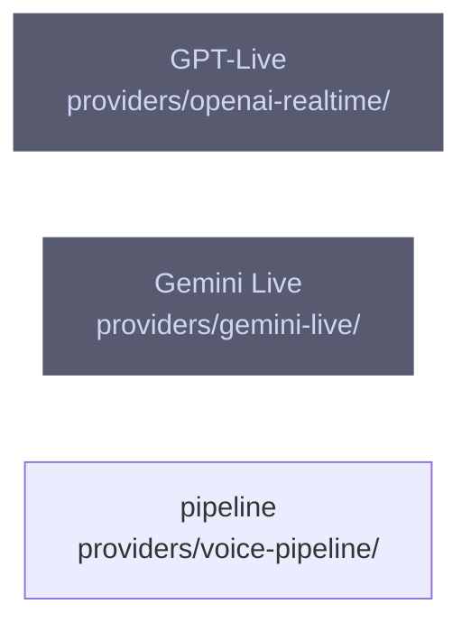

# overall-architecture/providers/voice-engines

[解析トップへ戻る](../../README.md) ・ [ひとつ上へ](../README.md)

VoiceEngine を実装する。gpt-live と gemini-live は音声から音声を直接生成し、pipeline は STT → Brain → TTS を組み合わせる。

## 要素

### gemini-live

Gemini の BidiGenerateContent に WebSocket で接続する VoiceEngine。セッション再開に対応する。

[説明を見る](gemini-live/README.md)

### openai-realtime

OpenAI の live セッションに WebSocket で接続する VoiceEngine。voice-kit の S2SVoiceSession とプロンプト・ツールを使う。

[説明を見る](openai-realtime/README.md)

### voice-pipeline

Deepgram の STT、任意の Brain、TTS を組み合わせる VoiceEngine。割り込みの方針と相づちを持つ。TTS は既定で OpenAI、CLI の --tts で Gemini や ElevenLabs に切り替える。

[説明を見る](voice-pipeline/README.md)
