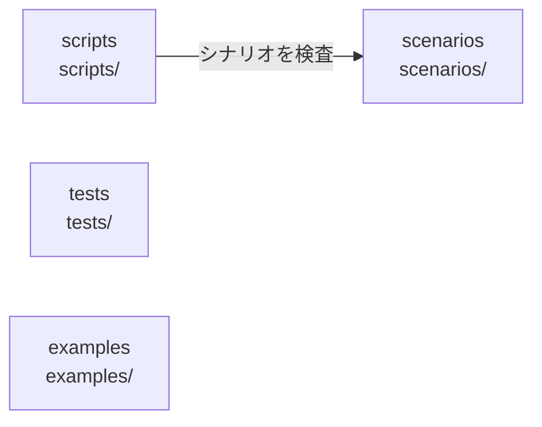

# overall-architecture/tooling

[解析トップへ戻る](../README.md) ・ [ひとつ上へ](../README.md)

シナリオ、検証スクリプト、UI の画面検査、動画制作。

## 要素

### examples

LiveKit の AgentSession に EvidenceEngine をつなぐ例など。

[説明を見る](examples/README.md)

### scenarios

シミュレータ用のシナリオ YAML（restaurant、hotel、shop、friend、casual、serial、adversarial）。adversarial には偽の完了を誘うシナリオがある。

[説明を見る](scenarios/README.md)

### scripts

ビルドと依存方向の検査（check-deps.mjs）、UI の実操作と撮影（scripts/ui/）、実機・結合の検証、動画とサイトの制作。

[説明を見る](scripts/README.md)

### tests

トップレベルの node:test（UI 証拠ゲート、話者表示の回帰、文字起こし配信）。パッケージ内の vitest とは別。

[説明を見る](tests/README.md)
