# request-lifecycle

[解析トップへ戻る](../README.md)

# 電話依頼が結果になるまで（Gateway）

1. 画面・チャネル・MCP から依頼が届き、Service が下書き（DRAFT）を作る。
2. review が内容を返し、改訂ごとに承認トークンを発行する。営業時間・停止リスト・同意も確認する。
3. 承認（POST /v1/missions/:id/start）で、トークン・冪等キー・月間上限・クレジット予約を確認して QUEUED にする。
4. Worker.tick が claimNext で依頼を取り、run で通話を始める。
5. Phone.execute が runtime・phone・voice と音声エンジンで通話し、Twilio で発信する。
6. Twilio の状態・同意フックが Phone.callback に届く。
7. 通話後、evaluateSales が EvidenceEngine と evaluate() で結果を判定する。拒否や連絡停止なら停止リストに入れる。
8. Credits が予約を確定または解放し、必要なら Alerts が職員に通知する。
9. 結果を元のチャネルに通知する。後続送信は別のプレビューと承認で行う。

```mermaid
graph LR
    intake["受付<br/>public/ ・ plugins/ ・ /mcp"]:::entry
    draft-review["下書きと確認<br/>Service.prepare / phoneRequest / review"]
    approval["承認<br/>Service.start"]
    dispatch["ワーカー<br/>Worker.tick / claimNext / run"]
    phone-call["通話<br/>Phone.execute"]
    carrier-hooks["Twilio フック<br/>/hooks/twilio/*"]:::external
    verdict["判定<br/>evaluateSales → evaluate()"]:::store
    settle["精算と通知<br/>Credits ・ Alerts ・ Service.notify"]
    followup["後続送信<br/>Followups.preview / execute"]
    intake -->|"依頼"| draft-review
    draft-review -->|"承認トークン"| approval
    approval -->|"QUEUED"| dispatch
    dispatch -->|"run"| phone-call
    carrier-hooks -->|"状態と同意"| phone-call
    phone-call -->|"発話"| verdict
    verdict -->|"結果"| settle
    settle -.->|"別承認で送信"| followup
    classDef entry fill:#89b4fa,stroke:#89b4fa,color:#1e1e2e
    classDef external fill:#585b70,stroke:#585b70,color:#cdd6f4
    classDef store fill:#a6e3a1,stroke:#a6e3a1,color:#1e1e2e
```

## 制約

承認なしには発信しない。完了は evaluate() だけが決める。結果が不明な通話や送信は自動でやり直さない。

## 要素

### approval

人間の承認で QUEUED にする。冪等キー、月間上限、クレジット予約を確認する。

[説明を見る](approval/README.md)

### carrier-hooks

状態、同意の DTMF、オプトアウトを通話イベントに変える。

[説明を見る](carrier-hooks/README.md)

### dispatch

同時実行数の上限内で依頼を取り出し、通話を始める。途中で止まった通話は UNKNOWN にし、再発信しない。

[説明を見る](dispatch/README.md)

### draft-review

下書き（DRAFT）を作り、改訂に結びついた承認トークンを発行する。

[説明を見る](draft-review/README.md)

### followup

メール・SMS・WhatsApp・予定・CRM への送信を、通話とは別に承認して行う。

[説明を見る](followup/README.md)

### intake

画面、チャネル（LINE・Slack・SMS・WhatsApp）、MCP からの依頼。

[説明を見る](intake/README.md)

### phone-call

runtime・phone・voice と音声エンジンで会話し、Twilio で発信する。冒頭で録音または記録の告知を流す。

[説明を見る](phone-call/README.md)

### settle

クレジットの確定・解放、職員通知、元のチャネルへの結果通知。

[説明を見る](settle/README.md)

### verdict

発話を証拠にして完了を決める。モデルの意見では決めない。

[説明を見る](verdict/README.md)
